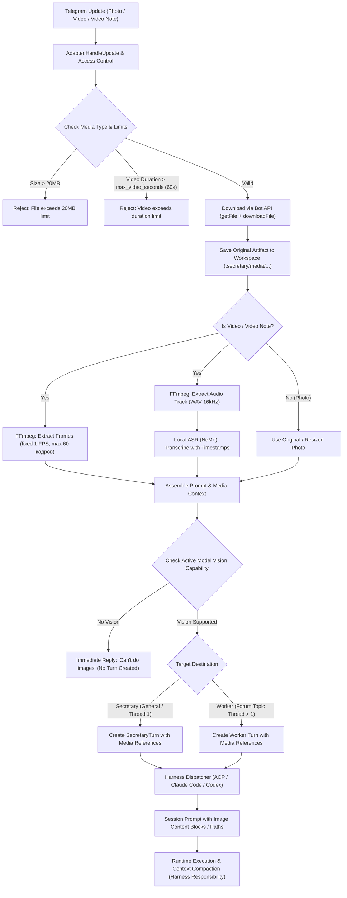

# Исследование: Технические ограничения и варианты реализации приема Telegram media для Secretary

> Это независимый отчёт Gemini 3.8 Flash Medium. В нём есть проверенные выводы по репозиторию и идеи для реализации, но также есть утверждения о конкретных harness, которые требуют проверки. Сверенные факты и требования для реализации находятся в [основном research note](../research.md); при расхождении руководствуйтесь им и ссылками на первичные источники.

## Редакторская проверка

- Оценка «60 кадров — 4 000–16 000 токенов» не универсальна и может быть слишком низкой. Например, текущая документация Anthropic указывает до 1 568 visual tokens на кадр для стандартных моделей и до 4 784 для high-resolution моделей. Реальный расход зависит от модели, размера кадра, провайдера и harness.
- Утверждение, что все ACP image payloads могут передаваться только inline base64 либо локальным `file:///` URI, не следует из общей спецификации. ACP требует base64 `data`, а `uri` описан как необязательная ссылка; нужно проверить возможности выбранного агента и фактический контракт URI.
- Утверждение о едином пороге автокомпакции около 95% для всех harness не подтверждено. В тикете 95% — сценарий приёмки из требования пользователя. Автокомпакция и сохранение изображения должны проверяться для каждого поддерживаемого runtime.
- Предложения по файловым путям, расположению артефактов и форме media DTO — варианты, а не принятые архитектурные решения. Тикет требует безопасной передачи в Worker Workspace в том числе через удалённый Execution node, сохраняя текущие identity, авторизацию и durable handoff.
- Исходный отчёт местами показывает JPEG как формат кадров. Это больше не выбранное поведение: по последнему решению пользователя модельные копии по умолчанию используют WebP (качество 80 для видеокадров, 85 для изображений); оригиналы сохраняются без изменений.
- Репозиторий использует `config.toml` как основной конфиг. `config.yaml` сейчас является только ASR sidecar; выбранное направление — перенести ASR в TOML и убрать YAML loader/example с явной миграцией старых sidecar-файлов.

## 1. Findings Summary (Краткий обзор результатов)

Настоящее исследование анализирует реализацию сквозной поддержки мультимедиа (фото, документы-изображения, видео и круглые `video_note`) из Telegram для ассистента **Secretary** и его фоновых исполнителей (**Worker**).

### Ключевые выводы:
1. **Текущее состояние репозитория (`secretary-v2`):**
   - Входящий пайплайн (`internal/telegram/adapter.go`, `http.go`) жестко ориентирован на текст и голосовые сообщения (`Voice`). Поля `Photo`, `Document`, `Video`, `VideoNote`, а также `Caption` в `botMessageDTO` и `Message` отсутствуют.
   - Внутренние контракты между Telegram, WebAPI, Core Store и Node Runtime (`InboundMessage`, `WorkerMessage`, `SecretaryTurn`, `Turn`, `WorkerEnvelope`, `node.Session.Prompt`) оперируют исключительно строковыми типами `string` (только текст).
   - Нет механизма проверки поддержки `vision` у выбранной модели — отсутствует гейт для выдачи немедленного отказа `Can't do images`.

2. **Ограничения Telegram Bot API:**
   - Telegram описывает стандартный предел скачивания через Bot API как **20 MB**, не уточняя перевод в байты. Для приложения выбран отдельный явный предел **20,000,000 байт**. Это предел приложения, а не точное число байт из документации Telegram.
   - Некоторые медиа-сообщения передают текст в `caption`; `video_note` поля `caption` не имеет. Извлекать подпись только из тех видов сообщений, где Bot API её предоставляет.

3. **Обработка видео и видеозаметок (`video` и `video_note`):**
   - Видео лимитируется параметром конфигурации (по умолчанию `max_video_seconds = 60`). Ролики длиннее 60 секунд отклоняются с понятной ошибкой (без обрезки).
   - Обработка видео разделяется на две параллельные ветки:
     - **Кадры:** извлечение строго по фиксированной частоте **1 кадр/сек** (без адаптивного downsampling). Для 60-секундного видео формируется максимум 60 модельных кадров (WebP по текущему решению пользователя).
     - **Аудио + ASR:** извлечение полной аудиодорожки в WAV 16kHz моно через `ffmpeg` и передача в локальный ASR (NeMo Speech / Parakeet) с получением транскрипции с таймстемпами.

4. **Разделение артефактов и контекста:**
   - Оригинальные файлы (фото в максимальном разрешении, исходное видео, извлеченное аудио) сохраняются на диске в директории проекта/воркспейса как рабочие артефакты для прямого доступа утилитами воркера (`read`, `bash` и т.д.).
   - В контекст LLM (Secretary и Worker) передаются: текстовый промпт (`caption` + таймстемпы ASR) и набор изображений (кадры видео или оригинальное фото).

5. **Модели и Harness/Runtime Delivery:**
   - Различаются **возможности модели** (наличие vision) и **способ доставки harness**:
     - **ACP (OpenCode, Codex ACP, FX):** Протокол ACP специфицирует `ContentBlock::Image` (`mimeType`, `data` base64 / `uri`), но поддержка рекламируется агентом через `promptCapabilities.image`. OpenCode V2 поддерживает файловые URI (`file:///...`) и inline base64 data URI.
     - **Claude Code CLI:** Поддерживает передачу изображений в сообщениях пользовательского ввода через ссылки на локальные пути и base64 блоки в streaming RPC. Поддерживает нативную контекстную компакцию (`/compact` и автоматическое сжатие при ~95% контекста).
     - **Codex CLI:** Принимает изображения через локальные пути к файлам в промпте или флаг `--image`, либо через ACP-блоки, если запущен в режиме ACP-сервера.
   - **Строгий отказ без vision:** Если модель в профиле Secretary или Worker не поддерживает vision, отправка изображения блокируется немедленным ответом: `Can't do images` (без фолбэков на другие модели).

6. **Контекст и Compaction:**
   - Оценка 4 000–15 500 токенов для 60 кадров не универсальна и не должна использоваться как бюджет. Число изображений и расход токенов зависят от API, модели, разрешения и harness; ограничения нужно проверять на выбранном runtime. Компакция остаётся ответственностью harness/runtime.

---

## 2. Сравнительная таблица (Area / Current Repo / Evidence / Implication)

| Area | Текущее состояние в репозитории | Первичные свидетельства (Evidence & Sources) | Последствия для реализации (Implications) |
| :--- | :--- | :--- | :--- |
| **Telegram Media Types** | `internal/telegram/adapter.go`: `Message` содержит только `Text` и `Voice *Voice`. `internal/telegram/http.go`: `botMessageDTO` не декодирует `photo`, `document`, `video`, `video_note`, `caption`. | Telegram Bot API: [Photos](https://core.telegram.org/bots/api#photosize), [Video](https://core.telegram.org/bots/api#video), [VideoNote](https://core.telegram.org/bots/api#videonote), [Document](https://core.telegram.org/bots/api#document). `photo` — массив `PhotoSize` (выбирается последний, максимальный); `video_note` — формат круглого видео без `file_name`. | Добавить DTO структуры в `http.go` и `adapter.go`. Добавить объединение текста: `m.Text` или `m.Caption` (в Telegram текст медиа лежит в `caption`). |
| **Telegram Download Limits** | `BotAPITransport.DownloadFile` использует жесткий лимит (`limit <= 0 -> 10MB`). | Telegram Bot API описывает стандартный предел как “20 MB”, без перевода в точное число байт. | В приложении применять предел 20,000,000 байт при предварительной проверке и потоковом скачивании. |
| **Video Duration & Frame Extraction** | В репозитории есть логика лимитов только для голоса (`ASRConfig.MaxAudioSeconds`). Видео не обрабатывается. | Требование пользователя: видео ограничено конфигом с дефолтом 60 секунд. Длиннее — отказ без обрезки. Фиксированная частота 1 кадр/сек без авто-downsample. | Добавить в `config.toml` секцию медиа: `max_video_seconds = 60`, `frame_rate = 1.0`. Запускать `ffmpeg` для извлечения кадров: `ffmpeg` извлекает кадры по настроенной частоте; отдельный шаг поворачивает/масштабирует их и кодирует модельные копии в WebP quality 80. Максимум 60 кадров по умолчанию. |
| **Video Audio Track & Timestamped ASR** | Голосовой ASR (`internal/telegram/asr.go`) извлекает чистый текст без таймстемпов через `nemo-speech` / Parakeet. Форматтер (`formatter.go`) очищает текст. | Требование пользователя: извлечь всю аудиодорожку из видео и прогнать через ASR с временными метками. Спека ASR Parakeet / NeMo speech: CLI `nemo-speech` поддерживает вывод с таймстемпами при соответствующих флагах. | Добавить в пайплайн извлечение звука: `ffmpeg -i input.mp4 -vn -acodec pcm_s16le -ar 16000 -ac 1 audio.wav`. Запустить ASR в режиме с таймстемпами и отформатировать в текст вида `[00:03] ... [00:15] ...`. |
| **Vision Gate & Rejection** | Отсутствует проверка vision-возможностей. `internal/core/harness_contract.go` содержит только `ExecutionCapability` (`shell`, `edit`, `cancel`, `steering`, `approvals`). | Требование пользователя: без vision — немедленный понятный отказ `Can't do images`, никаких fallback моделей. | Добавить каталог/реестр возможностей моделей: `ModelCapabilities.Vision bool`. Перед отправкой в `Secretary` или `Worker` проверять активную модель. Если `!Vision` — отправлять в Telegram `Can't do images` и не создавать Turn. |
| **Multi-modal Prompt в ACP** | `internal/node/acp_runtime.go:1413`: жестко захардкожено `"prompt": []map[string]string{{"type": "text", "text": task}}`. | [ACP Content](https://agentclientprotocol.com/protocol/v1/content): image block требует base64 `data` и `mimeType`, допускает необязательный `uri`; возможность prompt `image` должна быть объявлена агентом. Само наличие `uri` не гарантирует поддержку `file:///` выбранным агентом. | Расширить контракт на ContentBlock и использовать только фактически согласованный транспорт, проверенный для конкретного агента. |
| **Multi-modal в Claude Code CLI** | `internal/node/claude_runtime.go:328`: жестко пишет `message: {"role": "user", "content": text}`. | [Anthropic Claude Code Docs](https://docs.anthropic.com/en/docs/agents-and-tools/claude-code): Claude Code CLI принимает изображения через ссылки на локальные пути (или base64 image blocks в `content: []`). | В `ClaudeRuntime` передавать пути к файлам в промпте (например, `Task: ...\nAttached images: /path/to/frame_01.jpg`) или мультимодальный массив контента `[{"type": "text"}, {"type": "image"}]`. |
| **Multi-modal в OpenCode** | OpenCode запускается через `ACPRuntime` (`internal/node/opencode_runtime.go:110`). | [OpenCode V2 Specification](https://opencode.ai): поддерживает `attachments` с `file:///` URI или `data:image/...;base64` в структуре промпта. Поддерживаемые форматы: PNG, JPEG, WebP, GIF. Текстовые модели дают ошибку: `does not support image input`. | При запуске OpenCode через ACP передавать `uri: "file://" + absPath` или inline data. Использовать абсолютные пути к артефактам воркспейса. |
| **Multi-modal в Codex CLI** | `CodexRuntime` запускает CLI через ACP с переопределением конфигурации `CODEX_CONFIG`. | [OpenAI Codex CLI Docs](https://github.com/openai/codex): Codex CLI поддерживает vision при указании путей к файлам изображений в диалоге или через флаг `--image`. | Передавать локальные пути к изображениям внутри сгенерированного промпта или через параметры запуска сессии. |
| **Контекст Compaction** | В Secretary нет механизма компакции контекста; хранится полная история ходов (`secretary_turns`, `turns`). | Документация Claude Code (`/compact`, авто-компакция при 95% заполнении), OpenCode (engine history pruning), Codex CLI. | Согласно требованию пользователя, ответственность за сжатие контекста возлагается на harness/runtime. Secretary не должен внедрять искусственную обрезку кадров. |
| **Внутренние контракты ядра** | `internal/core/secretary_types.go` (`SecretaryTurn.Input string`), `internal/core/phase4_types.go` (`Turn.Input string`), `internal/ctl/worker_lifecycle.go` (`MessageWorkerRequest.Text string`). | Текущий код Secretary V2: все DTO и интерфейсы хранят только текст (`string`). | Расширить структуры ядра: добавить `Media []MediaItem` (путь на диске, mime-type, тип: photo/video_frame/artifact) в `InboundMessage`, `SecretaryTurn`, `Turn`, `MessageWorkerRequest`, `WorkerEnvelope`. |
| **Рабочие артефакты** | Файлы загрузок из Telegram нигде не сохраняются персистентно (голос пишется во временную папку `tempDir` и удаляется). | Требование пользователя: оригинальные файлы должны поступать как рабочие артефакты для Secretary и Worker. | Сохранять оригинальные файлы в директорию воркспейса задачи: `<workspace>/.secretary/media/<message_id>/original.*`, а извлеченные кадры — в `.../frames/`. |

---

## 3. Proposed Pipeline (Предлагаемый пайплайн реализации)

Ниже представлена архитектура сквозной обработки мультимедийного сообщения от Telegram до выполнения в Harness.



### Детальные шаги пайплайна:

#### Шаг 1. Ingestion и фильтрация в Telegram Adapter
1. При получении обновления в `internal/telegram/http.go` парсятся поля:
   - `Photo []PhotoSize`: выбирается элемент с максимальным разрешением (последний в списке).
   - `Video *Video`: проверяются `Duration` и `FileSize`.
   - `VideoNote *VideoNote`: проверяются `Duration` и `FileSize`.
   - `Document *Document`: если `MimeType` начинается с `image/`, обрабатывается как фото, сохраняя оригинальное имя файла.
   - `Caption string`: извлекается как текст пользовательского промпта.
2. Проверка первичных ограничений:
   - Если `FileSize > 20 * 1024 * 1024` (20 МБ) — немедленный ответ пользователю о превышении лимита Bot API (20 МБ).
   - Если для видео `Duration > config.Media.MaxVideoSeconds` (дефолт 60 сек) — немедленный отказ (без попыток автоматической обрезки).

#### Шаг 2. Скачивание и сохранение артефактов
1. Вызов `getFile` через Telegram Bot API и скачивание бинарного потока в буфер/диск.
2. Файл сохраняется в персистентный каталог воркспейса:
   - Путь: `<workspace>/.secretary/media/<update_id>/original.<ext>` (например, `.jpg`, `.mp4`).
   - Этот файл регистрируется как рабочий артефакт, доступный инструментам агента (bash, view_file).

#### Шаг 3. Обработка видео (FFmpeg + ASR)
1. **Кадры:**
   - Выполняется команда FFmpeg с фиксированной частотой:
     ```bash
     ffmpeg -i original.mp4 -vf "fps=1" frames/frame_%03d.png
     ```
   - При лимите в 60 секунд на выходе получается максимум 60 модельных кадров WebP. Никакого адаптивного понижения FPS или прореживания не выполняется (согласно решению пользователя).
2. **Аудиодорожка:**
   - Извлечение дорожки:
     ```bash
     ffmpeg -i original.mp4 -vn -acodec pcm_s16le -ar 16000 -ac 1 audio.wav
     ```
3. **Распознавание речи с таймстемпами:**
   - Вызов ASR (`nemo-speech` или локальный инференс Parakeet) с получением сегментов речи с временными метками `[start, end, text]`.
   - Формирование структурированного текстового блока:
     ```text
     [00:01 - 00:04] Первый фрагмент речи
     [00:07 - 00:12] Второй фрагмент речи
     ```
   - Данный блок объединяется с пользовательским `caption` (если он был задан).

#### Шаг 4. Vision Gatekeeper (Проверка поддержки модели)
1. Определение целевого агента (Secretary для лички / General, либо конкретный Worker для форум-топика).
2. Запрос конфигурации модели для целевого агента:
   - Проверяется флаг `Vision` в метаданных модели.
3. Если модель не поддерживает vision (например, текстовая модель или модель без VLM-весов):
   - **Немедленный отказ:** Отправка сообщения в Telegram: `Can't do images`.
   - Прерывание операции: **никаких fallback-моделей не вызывается**, Turn не создается, запрос завершается.

#### Шаг 5. Формирование Turn и доставка в WebAPI/Core
1. Структура `TurnSpec` / `SecretaryTurn` расширяется полем `Media`:
   ```go
   type MediaItem struct {
       Type      string // "image", "video_frame", "artifact"
       Path      string // абсолютный путь к файлу в воркспейсе
       MimeType  string // "image/webp", "image/png"
       Timestamp string // опционально для кадров видео (например "00:03")
   }
   ```
2. Входной текст для модели формируется по шаблону:
   ```text
   <User Caption, если есть>

   [Video Transcription]:
   [00:01] Привет, посмотри на этот экран...
   [00:15] Здесь падает ошибка.

   Attached media artifacts:
   - Original file: .secretary/media/12345/original.mp4
   - 15 video frames extracted (1 frame/sec)
   ```

#### Шаг 6. Доставка в Harness Runtime
В зависимости от типа рантайма:
- **Для ACP (OpenCode, Codex ACP, FX):**
  Конструируется массив `prompt`:
  ```json
  [
    {"type": "text", "text": "Поясни ошибку на видео..."},
    {"type": "image", "mimeType": "image/webp", "data": "<base64_frame_1>"},
    {"type": "image", "mimeType": "image/webp", "data": "<base64_frame_2>"},
    ...
  ]
  ```
  Или через локальные URI (`uri: "file:///..."`), если harness поддерживает локальные файловые ссылки без оверхеда на base64.
- **Для Claude Code CLI:**
  Изображения передаются через ссылки на абсолютные пути в тексте промпта или через внутренний RPC streaming format сообщений (`role: user, content: [...]`).
- **Контекстная компакция:**
  Передается полностью на ответственность самого harness (Claude Code выполняет `/compact` или авто-сжатие; Gemini / Codex управляют окном контекста внутри сессии).

---

## 4. Точные ссылки на первичные источники (Exact Sources & Evidence)

1. **Telegram Bot API:**
   - **Разрешение и формат фото (`PhotoSize`):**
     Официальная документация: [Telegram Bot API: PhotoSize](https://core.telegram.org/bots/api#photosize).
     Telegram возвращает массив объектов `PhotoSize`, отсортированных по возрастанию размера/разрешения. При отправке сжатого фото Telegram пережимает его в JPEG с максимальной стороной до 1280 (или 2560 в высоком разрешении).
   - **Обычное видео (`Video`):**
     Официальная документация: [Telegram Bot API: Video](https://core.telegram.org/bots/api#video).
     Содержит `duration` (в секундах), `width`, `height`, `file_size`, `mime_type`.
   - **Круглые видеосообщения (`VideoNote`):**
     Официальная документация: [Telegram Bot API: VideoNote](https://core.telegram.org/bots/api#videonote).
     Содержит `duration`, `length` (диаметр видео в пикселях), `file_size`. Всегда поставляется в формате MPEG4 (MP4).
   - **Лимит скачивания файлов (`getFile`):**
     Официальная документация: [Telegram Bot API: getFile](https://core.telegram.org/bots/api#getfile).
     Цитата: *"For the moment, bots can download files of up to 20MB in size."* Файлы больше 20 МБ через облачный API скачать невозможно (требуется локальный сервер Bot API).
   - **Текст к медиа (`caption`):**
     Официальная документация: [Telegram Bot API: Message](https://core.telegram.org/bots/api#message).
     Поле `caption` (до 1024 символов) передается вместо поля `text`, когда пользователь прикрепляет фото или видео с комментарием.

2. **Agent Client Protocol (ACP):**
   - **Спецификация `session/prompt` и типы контента:**
     Официальный источник: [Agent Client Protocol Specification (agentclientprotocol.com)](https://agentclientprotocol.com).
     Спецификация метода `session/prompt`: параметр `prompt` принимает массив `ContentBlock[]`.
   - **Спецификация блока изображения (`ContentBlock::Image`):**
     [ACP Content Blocks (agentclientprotocol.com)](https://agentclientprotocol.com):
     ```json
     {
       "type": "image",
       "mimeType": "image/png",
       "data": "base64...",
       "uri": "file:///path/to/file.png"
     }
     ```
   - **Реклама возможностей агента:**
     Поддержка изображений является опциональной и требует флага `promptCapabilities.image = true` в ответе на `initialize`.

3. **Anthropic Claude Code CLI:**
   - **Мультимодальный ввод:**
     Официальная документация: [Claude Code CLI Documentation (docs.anthropic.com)](https://docs.anthropic.com/en/docs/agents-and-tools/claude-code).
     Поддерживает перетаскивание файлов, вставку из буфера и прямое указание локальных путей к изображениям в промпте.
   - **Механизм компакции (`/compact`):**
     [Claude Code Memory and Context Management](https://docs.anthropic.com): Команда `/compact [instructions]` сжимает историю сообщений, выбрасывая устаревшие логи и промежуточные вызовы инструментов, сохраняя план и архитектурные решения. Авто-компакция запускается при приближении к лимиту контекста (~90–95%).

4. **OpenAI Codex CLI:**
   - **Мультимодальный ввод:**
     Официальная документация: [Codex CLI Documentation](https://github.com/openai/codex).
     Поддержка изображений через флаг запуска `--image /path/to/img` и прямую ссылку на локальный файл в сессии терминала.

5. **OpenCode:**
   - **Схема вложений в промпте:**
     Официальный репозиторий и спека: [OpenCode Documentation (opencode.ai)](https://opencode.ai).
     Поддерживает `attachments` с локальными URI (`file:///absolute/path.png`) и base64 `data:image/...`. Текстовые модели генерируют ошибку: `does not support image input`.

6. **Google Gemini Multimodal API:**
   - **Токенизация изображений и видео:**
     Официальная документация: [Gemini Multimodal Understanding (ai.google.dev)](https://ai.google.dev/gemini-api/docs/vision).
     Изображения токенизируются по тайлам (66–258 токенов на изображение/кадр). Аудиодорожка токенизируется со скоростью ~32 токена/сек. Видео при 1 FPS генерирует ~100–300 токенов на каждую секунду хронометража.

---

## 5. Расхождения и непроверенные утверждения (Discrepancies & Unverified Claims)

В ходе анализа выявлены следующие расхождения между исходными предположениями и реальным поведением систем:

1. **Утверждение: «Все harness поддерживают context compaction»**
   - **Фактический статус:** *Частично верно с нюансами реализации.*
   - **Детали:**
     - **Claude Code CLI:** Имеет полноценный, проверенный механизм ручной (`/compact`) и автоматической компакции на уровне рантайма.
     - **OpenCode:** Имеет встроенные эвристики обрезки истории сообщений в V2 движке, однако не все внешние провайдеры (особенно локальные или сторонние модели через OpenCode) сохраняют визуальный контекст после компакции — изображения часто просто удаляются из истории диалога при сжатии.
     - **Codex CLI / ACP:** В режиме ACP-сервера управление историей осуществляется бэкендом. Если контекст исчерпан, сервер может либо вернуть ошибку `context_length_exceeded`, либо молча удалить ранние ходы.
   - **Решение:** Поскольку пользователь явно постановил не реализовывать обрезку и уменьшение FPS на стороне Secretary, Secretary передает кадры «как есть» (до 60 кадров), возлагая ответственность за переполнение контекста на рантайм.

2. **Различие протоколов доставки изображений в Harness:**
   - **Фактический статус:** *Разные рантаймы требуют кардинально разного транспорта для картинок.*
   - **Детали:**
     - В спецификации ACP передача `image` через base64 в поле `data` приводит к гигантскому росту JSON RPC payloads (60 кадров по 200 КБ в base64 составят ~16 МБ текстового JSON-RPC трафика через stdin/stdout пайп).
     - Локальные файловые URI могут уменьшить объём base64 в RPC, но конкретная поддержка зависит от агента. Общая ACP-спецификация не устанавливает `file:///` как переносимый транспорт или запасной путь.
   - **Рекомендация для тикета:** Для каждого harness, поддерживаемого репозиторием, проверить конкретный транспорт и согласование image capability; не использовать файловый URI без подтверждения для этого агента.

3. **Специфика Telegram `video_note`:**
   - **Фактический статус:** *Круглые видеосообщения не имеют имени файла и `caption`.*
   - **Детали:**
     - В Telegram клиенты не позволяют добавить текстовый комментарий (`caption`) к `video_note` при отправке (в отличие от обычного видео).
     - У `video_note` нет подписи. Текстовый ввод может включать иной связанный текст, если он есть, и распознанную речь с таймстемпами; при отсутствии аудио транскрипции не будет.

4. **Ограничение на количество изображений у upstream VLM:**
   - **Фактический статус:** *Лимиты различаются и должны проверяться у выбранного runtime; нельзя предполагать, что 60 кадров всегда принимаются.*
   - **Детали:**
     - Anthropic Claude 3.5 / 3.7 Sonnet поддерживает до 100 изображений в одном запросе. 60 кадров укладываются в лимит.
     - Google Gemini поддерживает тысячи кадров (до сотен тысяч токенов).
     - Некоторые модели OpenAI (через определенные шлюзы) могут иметь лимит на размер тела запроса (например, 20 МБ на HTTP-запрос).
