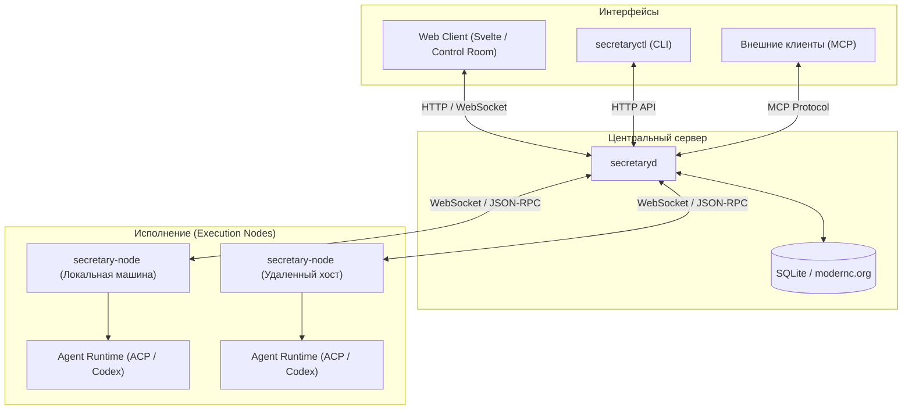

# Secretary v2

**Secretary** — персональный ассистент и оркестратор задач на Go, объединяющий долгосрочную контекстную переписку с надежным делегированием поручений фоновым воркерам.

Система устраняет необходимость вручную переносить рабочий контекст, историю и результаты между разными сессиями, терминалами и физическими машинами.

---

## Архитектура



### Компоненты системы

- **`secretaryd`** — центральный сервер и координатор: управление очередью задач, сессиями переписки, ролевым доступом и оркестрацией воркеров.
- **`secretaryctl`** — CLI-утилита для администрирования, запуска задач и инспекции текущего состояния системы.
- **`secretary-node`** — агент выполнения воркеров на целевой машине. Подключается к серверу по исходящему защищенному каналу, исключая необходимость входящих портов.
- **`secretary-mcp`** — реализация протокола Model Context Protocol (MCP) для предоставления инструментов внешним LLM-клиентам.
- **`internal/core`** — ядро бизнес-логики: хранилище SQLite, миграции схемы, жизненный цикл задач (Task, Worker, Attempt, Result).
- **`internal/acp`** — слой адаптера для взаимодействия с агентскими средами по протоколу Agent Client Protocol (ACP).
- **`web/`** — адаптивный веб-интерфейс и Control Room (Svelte, Vite, Tailwind CSS).

---

## Ключевые возможности

1. **Непрерывная долговременная переписка.** История диалога сохраняется в локальной базе данных и доступна со всех подключенных клиентов. Основной контекст беседы не теряется при смене сессий или перезапуске воркеров.
2. **Память и персонализация.** Явно запрошенные владельцем факты и предпочтения сохраняются в редактируемых `memory.md` и `user_preferences.md`; существующий `user.md` сохраняется и остаётся доступным для совместимости. [Документация памяти](docs/memory.md).
3. **Асинхронное делегирование воркерам.** Пользователь может продолжать общение с ассистентом, пока воркер выполняет объемную фоновую задачу. Промежуточный прогресс доступен в отдельном потоке, а финальный результат возвращается в общий чат.
4. **Управление несколькими машинами.** Единый сервер `secretaryd` может распределять нагрузку и направлять задачи на разные подключенные узлы (`secretary-node`).
5. **Гибкость сред исполнения.** Поддержка запуска агентских runtime с выбором провайдеров и моделей через стандартизированный протокол ACP.

---

## Архитектурные особенности и ограничения

- **Модель доверия и изоляция:** В базовой локальной конфигурации воркер выполняется с правами текущего пользователя. Для изолированного запуска команд изоляция настраивается на уровне целевого узла (контейнеры, cgroups).
- **Среды исполнения:** Основной рабочий harness оптимизирован под Codex через `codex-acp`. Архитектура спроектирована модульно и предусматривает подключение других сред через общий контракт runtime.
- **Сетевая связанность:** Узлы `secretary-node` инициируют исходящие соединения к `secretaryd`, что обеспечивает надежную работу через NAT без проброса портов.

---

## Быстрый старт и запуск

### Требования
- Go 1.27.1+
- Node.js 20+ (для веб-интерфейса)

### Установка и настройка

На macOS/Linux с Git, zsh, OpenSSL и Go 1.27.1+ (или mise) доступна установка одной командой:

```sh
curl -fsSL https://raw.githubusercontent.com/GitHubFoxy/secretary/main/scripts/install.sh | bash
```

В существующем checkout: `./secretary setup --interactive`. Можно выбрать **Codex или Claude Code** — оба одновременно не требуются. `secretary config` открывает терминальную конфигурацию harness, локального Node и Telegram; браузер и отдельный аккаунт Secretary не нужны.

```sh
secretary start --no-open
secretary node start
secretary doctor
secretary install-service
```

На Linux используется systemd user, на macOS — launchd. Подробнее: [терминальная установка](docs/terminal-install.md) и [быстрый старт](docs/quickstart.md).

### Тестирование и сборка

```sh
# Тесты backend (Go)
go test ./...

# Тесты и сборка веб-интерфейса
npm test --prefix web
npm run build:all --prefix web
```

Подробная документация: [быстрый старт](docs/quickstart.md), [конфигурация](docs/configuration.md), [глоссарий домена](GLOSSARY.md), [архитектурные контракты](docs/architecture/runtime-contracts.md).
