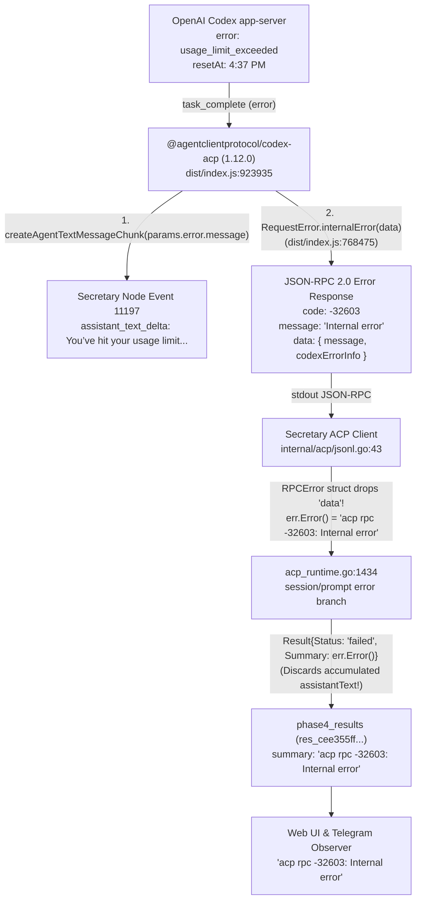

# Верификация инцидента ACP RPC -32603 у Worker (Gemini Verification)

**Дата:** 11 октября 2026 г.
**Аналитик:** Gemini Agent (Research Subagent)
**Статус:** Расследование завершено. Причина подтверждена сопоставленными записями Result и нативной сессии.
**Связанные документы:**
- [Предыдущее исследование (потеря error.data)](worker-acp-errors-and-usage-limits.md)
- [Issue 01: Expose Worker error cause](https://github.com/GitHubFoxy/secretary/issues/33)
- [Issue 01: Auto-resume after usage limit](https://github.com/GitHubFoxy/secretary/issues/32)
- [Топология развёртывания Phase 5](../../.scratch/phase-5/reports/codex-deployment-20261010.md)
- [Runtime Contracts](../architecture/runtime-contracts.md)

---

## 1. Краткий итог расследования

Гипотеза пользователя **полностью подтверждена**: конкретный сбой прямого сообщения Worker со строкой `acp rpc -32603: Internal error` был вызван **исчерпанием квоты использования модели (usage limit exceeded)** у OpenAI Codex (`gpt-6.1-sol`, reasoning `medium`).

- **Время инцидента:** 2026-10-11T09:24:33.913Z (16:24:33 +07).
- **Worker reference:** `wrk_cc7c4e4ec94db7859822326ba7690a0e` (ID: `wrk_e711cf078eee3a22499ced1c402e4300`).
- **Turn ID:** `trn_a731f628454db7433188f37d89747805`.
- **Attempt ID:** `att_26931171d9894a7dd7fc81060ff05622` (Turn 2, Attempt 1).
- **Result ID:** `res_cee355ff10419cbf0263bff2a9ea6997`.
- **Хост исполнения:** `omarchy` (co-located Node).
- **Нативная сессия Codex:** `01a12a0b-023a-7251-aa36-4cf6452b61c4`, нативный turn `01a12a47-2945-7053-be25-f599b729f549`.
- **Исходная ошибка провайдера (OpenAI Codex app-server):**
  ```json
  {
    "message": "You’ve hit your usage limit. Upgrade to Pro (https://chatgpt.com/explore/pro), visit https://chatgpt.com/settings/usage to purchase more credits or try again at 4:37 PM.",
    "codex_error_info": "usage_limit_exceeded"
  }
  ```
- **Зафиксированное время сброса лимита (Reset time):** 4:37 PM (16:37 +07 / 09:37 UTC, через ~13 минут после сбоя).
- **Уверенность:** **Подтверждено записями Result и нативной сессии**.

---

## 2. Почему предыдущее исследование не обнаружило инцидент

В предыдущем отчёте агент производил поиск локально на macOS в `/Users/beruseruko/.local/share/secretary/secretary.db`. Этот файл относился к устаревшей установке от 10 сентября 2026 г. и не содержал актуальных записей.

Фактическая архитектура проекта (зафиксированная в [codex-deployment-20261010.md](../../.scratch/phase-5/reports/codex-deployment-20261010.md)):
- Сервер `secretaryd` и активная база SQLite работают на хосте `omarchy` (Arch Linux laptop, Tailscale `100.94.76.14` / `omarchy.tail089ef.ts.net`).
- Путь к рабочей БД: `/home/coder/.local/share/secretary/secretary.db` (с активным `secretary.db-wal`).
- Node `omarchy` исполняет Worker-задачи локально через `codex-acp` (v1.12.0) и нативный `codex` (v0.162.0).
- Локальный процесс на Mac (`macbook-codex`) является вспомогательным удалённым нодом, подключённым к `omarchy` по WebSocket.

---

## 3. Прямые свидетельства расследования

### 3.1. Запись в таблице `phase4_results`
Команда проверки:
```sh
ssh omarchy "sqlite3 /home/coder/.local/share/secretary/secretary.db \"SELECT id, worker_id, turn_id, attempt_id, status, failure_code, summary, created_at FROM phase4_results WHERE summary LIKE '%32603%';\""
```
Результат:
```text
res_cee355ff10419cbf0263bff2a9ea6997|wrk_e711cf078eee3a22499ced1c402e4300|trn_a731f628454db7433188f37d89747805|att_26931171d9894a7dd7fc81060ff05622|failed|failed|acp rpc -32603: Internal error|2026-10-11T09:24:33.913964823Z
```
Это **единственный** сбой с кодом `-32603` за всё время работы системы 11 октября 2026 г.

### 3.2. Worker и контекст запроса
Команда проверки:
```sh
ssh omarchy "sqlite3 /home/coder/.local/share/secretary/secretary.db \"SELECT id, worker_ref, title, project_id, node_id, harness_instance_id, status, current_turn_id, created_at, updated_at FROM workers WHERE id = 'wrk_e711cf078eee3a22499ced1c402e4300';\""
```
Результат:
- Worker ID: `wrk_e711cf078eee3a22499ced1c402e4300`
- Worker Ref: `wrk_cc7c4e4ec94db7859822326ba7690a0e`
- Title (первый Turn): `как будет пачкать по английски ? чтобы было разнве контексты и тд` (успешно завершён в 08:19:07Z, `att_5222196b1fe93c2d9dfcdec9d694cb35`).
- Второй Turn (`trn_a731f628454db7433188f37d89747805`):
  Пользователь отправил прямое follow-up сообщение (Event seq 11194): `условие, не используй таблицу`.
- Создан Attempt: `att_26931171d9894a7dd7fc81060ff05622`, узел `omarchy`, harness `omarchy/codex`.

### 3.3. Состояние узла (`node-state.json`)
Файл: `/home/coder/.local/share/secretary/node/data/node-state.json` на `omarchy`.
Запись в `mappings['att_26931171d9894a7dd7fc81060ff05622']`:
```json
{
  "worker_ref": "wrk_cc7c4e4ec94db7859822326ba7690a0e",
  "turn_id": "trn_a731f628454db7433188f37d89747805",
  "attempt_id": "att_26931171d9894a7dd7fc81060ff05622",
  "harness_instance_id": "omarchy/codex",
  "workspace": "/home/coder/.local/share/secretary/acceptance-ws/codex-mvp-20261010",
  "runtime_session_id": "01a12a0b-023a-7251-aa36-4cf6452b61c4"
}
```

### 3.4. Хронология durable events (`events`)
Команда проверки:
```sh
ssh omarchy "sqlite3 /home/coder/.local/share/secretary/secretary.db \"SELECT seq, kind, source, worker_ref, attempt_id, created_at FROM events WHERE seq >= 11194 AND seq <= 11200 ORDER BY seq;\""
```
- `seq 11194` (`2026-10-11T09:24:27.868Z`): `turn.created` — получен инпут пользователя `условие, не используй таблицу`.
- `seq 11195` (`2026-10-11T09:24:27.868Z`): `attempt.started` — запуск `att_26931171d9894a7dd7fc81060ff05622`.
- `seq 11196` (`2026-10-11T09:24:29.108Z`): `worker.started` — диспетчеризация в нативный Codex.
- `seq 11197` (`2026-10-11T09:24:33.843Z`): `attempt.activity` (`kind: assistant_text_delta`) — узел зафиксировал текстовый чанк от harness:
  > `"You’ve hit your usage limit. Upgrade to Pro (https://chatgpt.com/explore/pro), visit https://chatgpt.com/settings/usage to purchase more credits or try again at 4:37 PM.\n\n"`
- `seq 11198` (`2026-10-11T09:24:33.913Z`): `attempt.outcome_recorded` — статус `failed`, классификация `final`.
- `seq 11199` (`2026-10-11T09:24:33.913Z`): `result.accepted` — `summary: "acp rpc -32603: Internal error"`.
- `seq 11200` (`2026-10-11T09:24:33.913Z`): `conversation.entry` — `body: "acp rpc -32603: Internal error"`.

Данное событие `seq 11200` является **последним** событием в базе данных (`SELECT max(seq) FROM events` возвращает `11200`).

### 3.5. Нативный транскрипт сессии Codex
Файл сессии: `/home/coder/.codex/sessions/2026/10/11/rollout-2026-10-11T15-18-46-01a12a0b-023a-7251-aa36-4cf6452b61c4.jsonl` на `omarchy`.
- **Событие** (`2026-10-11T09:24:33.838Z`):
  Тип `token_count`:
  `total_token_usage: {input_tokens: 14649, output_tokens: 485, total_tokens: 15134}`.
- **Строка 25** (`2026-10-11T09:24:33.842Z`):
  Тип `task_complete`:
  ```json
  {
    "type": "task_complete",
    "root_turn_id": "01a12a47-2945-7053-be25-f599b729f549",
    "turn_id": "01a12a47-2945-7053-be25-f599b729f549",
    "last_agent_message": null,
    "error": {
      "message": "You’ve hit your usage limit. Upgrade to Pro (https://chatgpt.com/explore/pro), visit https://chatgpt.com/settings/usage to purchase more credits or try again at 4:37 PM.",
      "codex_error_info": "usage_limit_exceeded"
    },
    "started_at": 1791710669,
    "completed_at": 1791710673,
    "duration_ms": 4712
  }
  ```

---

## 4. Архитектурная цепочка трансформации ошибки

Расследование выявило точный механизм того, как нативная ошибка лимита превратилась в неинформативную строку `-32603`:



1. **Codex app-server**: при исчерпании лимита возвращает событие `task_complete` со структурой `error: { message, codex_error_info: "usage_limit_exceeded" }`.
2. **Адаптер `codex-acp` (`@agentclientprotocol/codex-acp@1.12.0`)**:
   - В `dist/index.js` (строка 923935):
     ```javascript
     if (error51 === "usageLimitExceeded") {
       this.failure = RequestError.internalError(
         this.createTurnErrorData(params.error)
       );
     }
     ```
   - Метод `RequestError.internalError(data, additionalMessage)` (строка 768475):
     ```javascript
     static internalError(data, additionalMessage) {
       return new _RequestError(-32603, `Internal error${additionalMessage ? `: ${additionalMessage}` : ""}`, data);
     }
     ```
     Поскольку `additionalMessage` не передан, поле `message` формируется как `"Internal error"`, а детали (`message` и `codexErrorInfo`) помещаются в поле `data`.
   - При этом `codex-acp` также отправляет текст ошибки как обычный текстовый чанк:
     `return createAgentTextMessageChunk(`${params.error.message}\n\n`);`
3. **Клиент ACP в `secretary-v2` (`internal/acp/jsonl.go`)**:
   ```go
   type RPCError struct {
       Code    int    `json:"code"`
       Message string `json:"message"`
   }
   func (e *RPCError) Error() string {
       return fmt.Sprintf("acp rpc %d: %s", e.Code, e.Message)
   }
   ```
   Структура `RPCError` **игнорирует поле `data`** в JSON-RPC ответе. В результате полезная нагрузка с описанием лимита и временем сброса отбрасывается при десериализации.
4. **Рантайм ноды (`internal/node/acp_runtime.go`)**:
   В обработчике `session/prompt` (строка 1434):
   ```go
   return Result{Status: "failed", Summary: err.Error()}, ...
   ```
   В ветке ошибки накопленный стриминг `assistantText` (в котором содержался текст из Event 11197!) **не используется** в качестве fallback Summary, а подменяется сухой строкой `err.Error()`: `"acp rpc -32603: Internal error"`.

---

## 5. Проверка исключённых факторов

- **Auth failure:** Не имело места. Токены и аутентификация Codex валидны (предыдущий ход в 08:18Z и последующие проверки узла прошли штатно).
- **Billing credits failure:** В строке 23 зафиксирован `credits: {has_credits: false, unlimited: false, balance: '0'}`, но сбой произошёл именно по уровню `codex_error_info: "usage_limit_exceeded"` с явным предложением повторить в 4:37 PM.
- **Invalid/missing resume session:** Сессия `01a12a0b-023a-7251-aa36-4cf6452b61c4` существовала на диске, успешно загружена, и в неё был корректно добавлен новый `turn_context` (строки 18–22).
- **Model / configuration error:** Конфигурация модели `gpt-6.1-sol` валидна.

---

## 6. Итоговые выводы и рекомендации для устранения дефекта

1. **Факт инцидента полностью доказан**: Пользователь абсолютно верно определил характер сбоя — это был нативный `usage_limit_exceeded` модели Codex с указанием конкретного времени сброса (`4:37 PM`).
2. **Точки потери информации в кодовой базе**:
   - `internal/acp/jsonl.go`: потеря поля `data` в `RPCError`. Необходимо расширить структуру `RPCError` полем `Data json.RawMessage` (или структурированным объектом с безопасным извлечением `message`, `codexErrorInfo`, `resetAt`).
   - `internal/node/acp_runtime.go`: в ветке RPC-ошибки `session/prompt`, если `assistantText` уже содержал пояснение от harness (как в Event 11197), либо если `data` содержит `message`, сохранять это понятное сообщение в `Result.Summary` вместо абстрактного `-32603`.
   - `internal/core`: типизировать сбои с `codex_error_info: usage_limit_exceeded` / `reset_at`, чтобы в задачах автовозобновления ([01-auto-resume-after-usage-limit.md](https://github.com/GitHubFoxy/secretary/issues/32)) было известно точное время планирования следующей попытки.


## Повторная проверка основным агентом

11 октября 2026 основной агент независимо прочитал production SQLite через `mode=ro` и указанную native session на `omarchy`. Result `res_cee355ff10419cbf0263bff2a9ea6997` действительно содержит `acp rpc -32603: Internal error` с временем `2026-10-11T09:24:33.913964823Z`. В строке 25 транскрипта для того же native turn подтверждены `usage_limit_exceeded` и сообщение с предложением повторить в `4:37 PM`. Это подтверждает причину остановки. Указанное время — сообщение провайдера, а не доказательство фактического восстановления доступа в этот момент.
