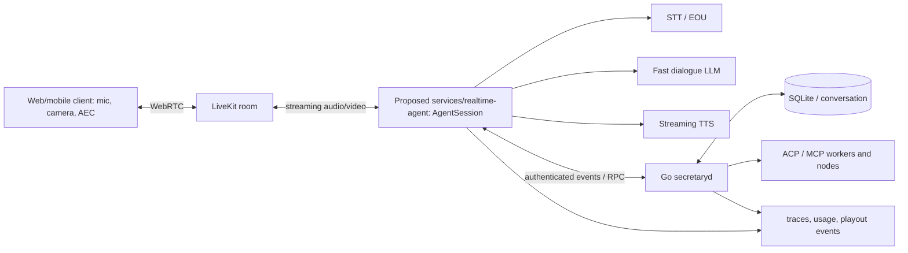

# Realtime voice and vision for Secretary — research and architecture

> **Snapshot:** 2026-10-16 · **Status:** design/research, not deployed or benchmarked · **Scope:** low-latency continuous voice, barge-in, camera/screen understanding, and durable background work.
>
> **Provenance:** This is an engineering reconstruction of the previous broad research report plus the subsequent LiveKit turn-taking review, **not a verbatim export of the original research artifact**. All recommendations are hypotheses until measured on our workload. See [the dated source register](references/realtime-voice-vision-sources.md) for primary URLs and a future revalidation procedure.

## Executive decision

Build a **hybrid modular streaming STT → fast dialogue LLM → streaming TTS** voice pipeline over **LiveKit/WebRTC**. Use LiveKit Agents' `AgentSession` for baseline end-of-turn, interruption, backchannel handling and preemptive generation; **do not build a second low-level TurnManager in MVP**. Keep existing Go `secretaryd` authoritative for conversation history, permissions, tools, ACP/MCP workers and long-running tasks. Add a proposed `services/realtime-agent` in Python or Node.js for the realtime media loop. Compare the whole pipeline against at least one **native speech-to-speech (S2S)** control on identical test data. [S01][S02][S04][S12]

### Candidate matrix — to test, not declared winners

| Component | First candidate | Alternative/control | What decides |
| --- | --- | --- | --- |
| Media | LiveKit/WebRTC | Native realtime provider transport | E2E jitter, AEC, video, reconnect |
| Streaming STT (RU/EN) | Deepgram Flux Multilingual | ElevenLabs Scribe v2 Realtime | WER/entity errors, EOU, p95 latency |
| Turn detection, supported languages | LiveKit Audio Turn Detector `v1` | `v1-mini`; STT endpointing | Premature turns vs delay |
| Turn detection, Russian | Deepgram Flux `turn_detection="stt"` | VAD-only and deprecated text detector as temporary comparator | RU mid-sentence pause corpus |
| Barge-in | LiveKit adaptive, if available | LiveKit VAD interruption | Stop latency, false interruptions |
| Dialogue LLM | Fast tool-capable model via adapter | Second provider/model | TTFT, tool correctness, RU/EN dialogue |
| Transcript cleanup | Optional lightweight model, outside critical voice path | ASR-native cleanup/no cleanup | Preserve exact meaning |
| TTS | Low-latency ElevenLabs candidate | Cartesia Sonic or other streaming TTS | First played sample, voice, cancellation |
| Native S2S | Gemini Live / OpenAI Realtime / Grok Voice candidate | Other available native audio | Overall naturalness, tools, vision, cost |
| Video | Sampled timestamped frames | Native Live video input | Grounding, cost, temporal correctness |

Model names and exact API IDs are mutable. Earlier research also considered GPT-6 Luna and Gemini Flash-Lite for *text formatting*, and StepAudio Realtime for S2S; **do not infer they are current production winners or that all model IDs are available without checking catalogs**. [S06][S09][S10][S12][S13]

## 1. Product requirements and invariants

Target a FaceTime-like experience: user may pause, self-correct, say `угу` as acknowledgement, interrupt with `нет, подожди`, show an object, and continue speaking while Secretary runs slow jobs.

1. **Single durable authority:** `secretaryd` owns canonical messages, state, worker lifecycle, tool authorization, SQLite persistence and audit trail.
2. **Two lanes:** latency-sensitive media/conversation loop and async work lane. An ACP/MCP tool call must not block audio processing.
3. **Always listening while speaking:** full-duplex mic input, acoustic echo cancellation (AEC), output playout tracking and cancellable speech.
4. **Heard ≠ generated:** track generated text, synthesized bytes, transmitted bytes and **client-played audio** separately. After barge-in, memory must not assert the user heard an unfinished answer.
5. **Transcript fidelity:** keep `raw_transcript`, `display_transcript` and `semantic_message` separately; no silent changes to negation, names, dates, money or commands.
6. **Timestamped perception:** associate speech and video frames by time; never imply an unseen frame was observed.
7. **User control and privacy:** explicit camera/mic consent, clear external provider routing, bounded media retention, and no secret or private recording in git.

## 2. Architecture and ownership



**Implementation boundary:** `services/realtime-agent` and the following events are proposed, not existing repository APIs. The current repo already describes `secretaryd`, `secretary-node`, SQLite, ACP/MCP and the Svelte web client in [README](../README.md).

Suggested versioned, authenticated, idempotent event contract:

- `user.turn.partial`: unstable STT hypothesis, UI only; no irreversible tools.
- `user.turn.committed`: finalized text, speech time range, referenced frame IDs and correlation ID.
- `assistant.reply.requested` / `assistant.reply.chunk`: stream of speakable text with `speech_id` and cancellation token.
- `assistant.playout.progress` / `assistant.playout.stopped`: client playback watermark and cancellation acknowledgement.
- `tool.request` / `tool.result` / `worker.progress`: routed through durable `secretaryd` authorization and lifecycle.
- `vision.frame.sampled`: source, timestamp, frame reference, retention/expiry.
- `session.reconnected`: restore state without blindly replaying already-heard speech.

Do not copy unbounded PCM or base64 frames into the permanent chat transcript. Use bounded ephemeral media storage with TTL and references.

## 3. Turn-taking — use LiveKit Agents first

**LiveKit WebRTC is transport; LiveKit Agents `AgentSession` is the turn-handling framework.** It covers end-of-turn detection, configurable endpointing, interruptions, false-interruption recovery, and preemptive LLM generation. The app still needs domain-level conversation coordination, tool cancellation and playout reconciliation. [S02][S04]

| Concern | What it answers | Failure to test |
| --- | --- | --- |
| VAD | Is there acoustic speech? | Background voices/noise |
| EOU / semantic turn detection | Has the user finished their thought? | `Запиши на завтра… [pause] …на пять` |
| Barge-in | Should assistant playback yield now? | `Нет, подожди, в пятницу` |
| Backchannel | Is `угу` only acknowledgement? | Wrongly stops assistant |
| False interruption recovery | Was the detected interruption just noise? | Assistant never resumes |
| Playout reconciliation | What did the listener actually hear? | Memory contains unheard words |

### 3.1 Russian vs supported languages

- **LiveKit Audio Turn Detector `v1`:** best first test for its **documented supported languages**; acoustic model, served by LiveKit Inference. `v1-mini` is the local CPU fallback. As checked on 2026-10-16, **Russian is not in the audio detector's 14-language list**. VAD and minimum silence constraints apply. Do not extrapolate RU support from the old text model. [S03]
- **Deepgram Flux Multilingual:** for RU/EN, test `deepgram/flux-general-multi`, `language="multi"`, and `turn_detection="stt"`. Flux has its own acoustic/semantic phrase endpointing, and LiveKit documents Russian in the multilingual model's language list. VAD remains useful for interruption. Try `endpointing.min_delay=0.0` **as an experiment**, not a universal best setting. [S06][S04]
- **LiveKit text `MultilingualModel`:** documented Russian support, but deprecated. Only a transitional A/B control, not the default long-term design. [S03]

### 3.2 Adaptive interruptions and realtime models

LiveKit adaptive interruption detection attempts to distinguish genuine barge-ins from backchannels acoustically. **Check prerequisites**: the documented feature is for LiveKit Cloud (with limited local development usage), a VAD input, and the ability to suppress backchannel before it reaches the LLM. Standard STT pipelines need aligned transcripts; otherwise fall back to VAD-based interruption. Language-independent intent does **not** mean proven identical accuracy across RU/EN. [S05]

When comparing native S2S, use **one turn authority**: either the provider's server-side turn detection or LiveKit-managed detection if the provider allows disabling its own. Avoid two independent EOU systems triggering duplicate responses. OpenAI Realtime documents server and semantic VAD options; they are a separate configuration from the LiveKit STT pipeline. [S02][S10]

### 3.3 Illustrative configuration — not a complete runnable agent

Verify SDK compatibility, STT adapter capabilities, credentials, LLM/TTS and session lifecycle against the pinned SDK. Adaptive mode will not work in every deployment. [S04][S05][S06]

```python
from livekit.agents import AgentSession, TurnHandlingOptions, inference

session = AgentSession(
    stt=inference.STT(
        model="deepgram/flux-general-multi",
        language="multi",
    ),
    turn_handling=TurnHandlingOptions(
        turn_detection="stt",
        endpointing={"min_delay": 0.0},
        interruption={"mode": "adaptive"},
    ),
)
```

**Critical acceptance test:** during interruption, stop client playback promptly, cancel future TTS chunks, and persist only the delivered part. LiveKit documents conversation-history truncation on interruption; verify actual client playout under packet jitter and reconnect. [S02][S16]

## 4. ASR, formatting, LLM, TTS and S2S

**Streaming ASR:** evaluate Deepgram Flux Multilingual and ElevenLabs Scribe v2 Realtime on the same RU/EN/code-switch audio. Capture *partial* vs *committed* transcripts, word/segment timestamps, end-of-turn events and named-entity errors. ElevenLabs documents WebSocket partial/committed results; provider latency claims are **not** microphone-to-speaker p95. [S06][S09]

**Do not confuse prerecorded ASR with live STT.** This repository already contains extensive research on *finished Telegram voice files*: [ASR](references/research-cloud-asr.md), [formatting](references/research-cloud-formatting.md), and [summary](references/research-cloud-summary.md). Reuse their pricing/privacy methodology, not their file-processing latency as streaming evidence. Offline leaderboard WER for models such as StepAudio/Fun-Realtime-ASR is likewise not an EOU or live-agent score.

**Fast dialogue LLM:** stream short, speakable clauses, support typed tool calls, keep the user informed while `secretaryd` workers continue. **Formatting LLM:** optional, asynchronous to voice reply, no tools, meaning-preserving, with raw-text fallback on timeout or detected corruption. Earlier shortlist (GPT-6 Luna, Gemini Flash-Lite, Cerebras) is a hypothesis; verify exact model ID, reasoning controls, price and language quality before adopting. [S18]

**Streaming TTS:** compare voice quality, RU/EN pronunciation, time to *first playable audio*, chunk continuity and cancellation. Previous research shortlisted ElevenLabs and Cartesia; verify current product/model IDs. Blind A/B listening and in-app playout timing outrank isolated vendor model inference speed. Track `speech_id`, chunk offsets and actual playout progress.

**Native S2S control:** compare one or more of Gemini Live, OpenAI Realtime, Grok Voice, or other available native speech models with the modular stack. Native S2S may improve prosody and overlap, while modular STT/LLM/TTS makes transcript audit, tool routing and provider substitution easier. Neither is inherently the winner. Artificial Analysis maintains S2S comparisons and arena data, but rankings and methodology change; snapshot both. [S10][S12][S13]

## 5. Vision: sampled frames and temporal context

Target **~1 FPS while the user speaks** and **~1 frame per 3 seconds while idle**, plus capture triggered by `look at this`/`вот это`. LiveKit documents those rates as defaults for live video input; Google Live documents a maximum **1 video frame per second**. When adding event-driven frames, enforce the destination model's effective cap. [S07][S08]

For modular LLMs, inject the most relevant recent frame(s), not an unbounded stream. Keep frame timestamps and source labels; downscale/compress, deduplicate and cap budget. Test deictic/temporal grounding: `the object I showed earlier` must resolve to the correct frame, not the newest unrelated frame. Video input does not decide speech turns. [S07]

## 6. Measurement: use end-to-end evidence

Define all latency measurements on monotonic clocks and distinguish vendor inference time from full user experience. LiveKit provides traces for E2E, STT, EOT, LLM TTFT and TTS TTFB; **instrument the client** for actual playback. [S15][S16]

| Metric | Measurement |
| --- | --- |
| Partial/final STT delay | Audio boundary → partial/final result |
| EOU delay | Human-annotated true turn end → committed EOU |
| Premature-turn rate | Continuations incorrectly committed early / all continuation cases |
| End-to-end first audible reply | True user-turn end → first **client-played** assistant sample |
| LLM TTFT / TTS TTFB | Per-stage, never conflated with end-to-end |
| Barge-in stop latency | User interruption onset → client playout stop |
| Backchannel false interruption | Acknowledgements that wrongly stop speech / all backchannels |
| RU/EN WER/CER and entity errors | Include names, dates, amounts, negations and code-switching |
| Vision grounding accuracy | Correct object/frame/time, not just plausible answer |
| Tool/task correctness | Correct args, permissions, worker completion and cancellation |
| Cost per real conversation minute | All STT/LLM/TTS/S2S, frames, retries, idle, infra and transport |

Report **p50/p90/p95, N, confidence intervals, failures and exclusions** by language, device, network, provider region, concurrency and cold/warm state. For pricing, capture currency, date, billing granularity, rate limits, retries and actual usage. Existing Telegram price tables are historical and not a quote for this realtime system.

## 7. Reproducible evaluation protocol — to implement

The proposed `eval/voice/` harness **does not exist yet**. Future work should add a consented, versioned corpus and replay harness:

- **Pause/EOU:** hesitations, unfinished syntax, 300–1500 ms mid-sentence pauses, true endings.
- **Overlap:** `угу`/`yeah` backchannels, `нет, стоп` genuine interruption, side conversation, TV speech, false positives.
- **Recognition:** RU/EN/code-switch, accents, noise, proper nouns, sums, dates, negations, corrections.
- **Playback:** cancellation during TTS, dropped packets, reconnect, false-interruption recovery and history truncation.
- **Vision:** object pointing, scene changes between frames, stale references, camera permission revocation.
- **Tools:** authorized vs unauthorized actions, slow ACP/MCP jobs, duplicate events, worker progress and cancel.

A proposed fixture record (schema must be implemented/versioned):

```json
{
  "id": "ru-pause-001",
  "audio_path": "fixtures/ru-pause-001.wav",
  "audio_sha256": "<sha256>",
  "language": "ru",
  "reference_text": "Запиши встречу на завтра часов на пять",
  "annotated_turn_end_ms": 4200,
  "events": [{"type": "mid_turn_pause", "start_ms": 1900, "end_ms": 2900}],
  "video_manifest": null,
  "consent_class": "synthetic"
}
```

For each run, preserve `run_id`, UTC time, git SHA, corpus hash/version, exact provider **model snapshot**, SDK/plugin lock versions, turn config and thresholds, client OS/browser/mic/AEC, audio codec/sample rate, network profile, provider region, cold/warm state, concurrency, source-register revision and dated price snapshot. Store redacted event JSONL, raw latency samples, aggregate results and error cases. **Never commit credentials or private recordings.**

**Required comparison:** (A) LiveKit audio detector on supported languages, (B) Flux Multilingual STT EOU on RU/EN, (C) VAD fallback, (D) at least one native S2S. Hold corpus and network conditions fixed; mark unavailable models `not tested`. Full-Duplex-Bench v1–v3 provides useful public turn-taking/overlap tasks, but published rankings are not substitutes for our Russian/English end-to-end results. [S11]

Do not assert numeric performance acceptance thresholds without a measured baseline. Gate releases on no unauthorized tool actions, correct playback-history reconciliation, low premature-turn/backchannel errors and measured latency/cost regressions.

## 8. Implementation sequence

1. **Voice MVP:** LiveKit room, AgentSession, streaming STT/LLM/TTS, AEC and client playout instrumentation.
2. **Natural turns:** RU/EN EOU A/B, adaptive vs VAD barge-in, backchannel handling, false-interruption recovery and heard-text reconciliation.
3. **`secretaryd` bridge:** versioned events, durable turn IDs, tools, async worker progress, reconnect, idempotency and permissions.
4. **Video:** 1 FPS/idle sampling, event frames, timestamped bounded cache and camera consent.
5. **Evaluation:** frozen corpus, replay, native S2S comparison, traces, p95/cost dashboard.
6. **Hardening:** privacy/retention, rate and cost caps, graceful fallback, network degradation, load testing and production release gates.

## 9. How to rebuild, retest and actualize

Use [the source register](references/realtime-voice-vision-sources.md) as the evidence index, not merely a bibliography.

1. **Rebuild the evidence:** open each primary URL; record `checked_at_utc`, the claim it supports, current model/SDK IDs, supported languages, deployment limits, data retention, pricing and what changed. Prefer release tags, Git commit SHA, dataset DOI and immutable model snapshots to mutable `main` URLs.
2. **Freeze the baseline:** pin repository SHA, SDK/plugin lockfile, config, dataset hash, model snapshot, provider region, device, network profile and price schedule. Archive source metadata and a legally appropriate link/snapshot; do not assume the vendor docs remain unchanged.
3. **Retest:** replay the same frozen corpus through old and new stacks; add a new regression corpus separately. Export raw traces, client playback events, transcript alignment, cost usage and failure cases. Compare p50/p95 with confidence intervals.
4. **Update the decision:** capture benchmark methodology and evaluation date alongside any leaderboard rank; never compare scores from different methodologies as though identical. Document winning config, tradeoffs, failed hypotheses and new limits.
5. **Review cadence:** monthly during prototyping; immediately on SDK/model/language/pricing/turn-detector releases; before each production rollout. Update this snapshot and register together in a PR.

### Change log

- **2026-10-16:** Initial reconstructed research snapshot and follow-up LiveKit turn-taking assessment. Added explicit Russian limitation of LiveKit Audio Turn Detector v1, Flux Multilingual endpointing A/B, adaptive-interruption deployment caveat, timestamped video policy, and reproducible retest procedure. **No provider API benchmark or production test was performed by this documentation change.**
